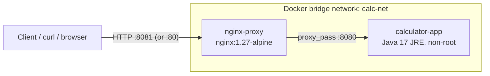

# Calculator REST API: DevOps Mini-Project

A lightweight **Java 17** REST API (built only on the JDK's `com.sun.net.httpserver.HttpServer`, no Spring Boot) that performs basic arithmetic. The project demonstrates a complete DevOps lifecycle: **Git/GitHub** (feature branches + pull requests), **Maven**, **Docker** (multi-stage build), **Docker Compose** (app + Nginx reverse proxy) and a **Jenkins** declarative CI/CD pipeline triggered by a **GitHub webhook**.

---

## Table of Contents

1. [Tech Stack](#tech-stack)
2. [Project Structure](#project-structure)
3. [Architecture](#architecture)
4. [API Reference](#api-reference)
5. [Configuration](#configuration)
6. [Build and Test Locally](#build-and-test-locally)
7. [Run with Docker](#run-with-docker)
8. [Run with Docker Compose](#run-with-docker-compose)
9. [CI/CD with Jenkins](#cicd-with-jenkins)
10. [Git Workflow](#git-workflow)
11. [Troubleshooting](#troubleshooting)

---

## Tech Stack

| Area | Technology |
|---|---|
| Language / runtime | Java 17 (Eclipse Temurin) |
| HTTP server | `com.sun.net.httpserver.HttpServer` (JDK built-in) |
| Build | Apache Maven 3.9, `maven-shade-plugin` (executable fat JAR) |
| Tests | JUnit 5 (unit + HTTP integration tests) |
| Containers | Docker (multi-stage, non-root), Docker Compose |
| Reverse proxy | Nginx |
| CI/CD | Jenkins (declarative pipeline), GitHub webhook, Docker Hub |

---

## Project Structure

```
calculator-devops/
├── .dockerignore
├── .gitignore
├── Dockerfile                  # Multi-stage build (Maven build -> JRE runtime, non-root)
├── Jenkinsfile                 # Declarative CI/CD pipeline
├── README.md
├── docker-compose.yml          # calculator-app + nginx-proxy on a bridge network
├── nginx.conf                  # Reverse proxy: port 80 -> calculator-app:8080
├── pom.xml
└── src/
    ├── main/java/com/calculator/
    │   └── App.java            # HTTP server, routing, calculator logic
    └── test/java/com/calculator/
        └── CalculatorTest.java # JUnit 5 unit + integration tests
```

---

## Architecture



- `calculator-app` listens on port **8080 inside the Docker network only**. It is not published to the host, which avoids clashing with Jenkins (which normally uses host port 8080).
- `nginx-proxy` is the only published service (host port **8081** by default, configurable).
- `nginx-proxy` starts only after `calculator-app` reports **healthy**.

---

## API Reference

All endpoints accept **GET** only and return `application/json; charset=utf-8`.

| Method | Path | Parameters | Example response |
|---|---|---|---|
| GET | `/api/v1/add?a=&b=` | `a`, `b` (numbers) | `{"operation": "add", "a": 2, "b": 3, "result": 5.0}` |
| GET | `/api/v1/subtract?a=&b=` | `a`, `b` | `{"operation": "subtract", "a": 10, "b": 4, "result": 6.0}` |
| GET | `/api/v1/multiply?a=&b=` | `a`, `b` | `{"operation": "multiply", "a": 3, "b": 4, "result": 12.0}` |
| GET | `/api/v1/divide?a=&b=` | `a`, `b` (`b` must not be 0) | `{"operation": "divide", "a": 10, "b": 2, "result": 5.0}` |
| GET | `/actuator/health` | none | `{"status": "UP"}` |

### Number formatting

- `a` and `b` are echoed as given: whole numbers without a decimal point (`2`), fractions as decimals (`2.5`).
- `result` is always a floating-point number (`5.0`, `0.25`). Very large or very small values use scientific notation (e.g. `1.0E7`), which is valid JSON.

### Error responses

Errors use the format `{"error": "<message>", "status": <code>}`.

| Situation | Status | `error` message |
|---|---|---|
| Missing or empty `a` / `b` | 400 | `Missing required query parameter: b` |
| Non-numeric value (e.g. `a=abc`, `a=NaN`) | 400 | `Parameter 'a' must be a valid number` |
| Number too large to represent (e.g. `a=1e999`) | 400 | `Parameter 'a' must be a finite number` |
| Division by zero (`b=0`) | 400 | `Division by zero is not allowed` |
| Result out of range (e.g. `1e308 * 10`) | 400 | `Result is out of range` |
| Malformed percent-encoding in the query | 400 | `Malformed query string` |
| Unknown path | 404 | `Endpoint not found` |
| Method other than GET | 405 | `Method not allowed` (with `Allow: GET`) |
| Unexpected server error | 500 | `Internal server error` |

### Examples

```bash
curl "http://localhost:8081/api/v1/add?a=2&b=3"
# {"operation": "add", "a": 2, "b": 3, "result": 5.0}

curl "http://localhost:8081/api/v1/divide?a=10&b=2"
# {"operation": "divide", "a": 10, "b": 2, "result": 5.0}

curl -i "http://localhost:8081/api/v1/divide?a=10&b=0"
# HTTP/1.1 400 Bad Request
# {"error": "Division by zero is not allowed", "status": 400}

curl "http://localhost:8081/actuator/health"
# {"status": "UP"}
```

> **Tip:** a literal `+` in a URL query means a space. To send a positive sign, encode it as `%2B` (e.g. `a=%2B5`).

---

## Configuration

| Variable | Used by | Default | Description |
|---|---|---|---|
| `PORT` | Java app | `8080` | Port the HTTP server listens on |
| `JAVA_OPTS` | Docker image | `-XX:MaxRAMPercentage=75.0 -XX:+ExitOnOutOfMemoryError` | JVM flags |
| `DOCKER_REPO` | Compose | `calculator-devops` | Image repository, e.g. `myuser/calculator-devops` |
| `IMAGE_TAG` | Compose | `latest` | Image tag to run |
| `NGINX_HOST_PORT` | Compose | `8081` | Host port published by Nginx (set to `80` to use port 80) |

---

## Build and Test Locally

**Prerequisites:** JDK 17 and Maven 3.9+.

```bash
# Run all tests (unit + HTTP integration tests)
mvn test

# Build the executable fat JAR -> target/calculator-devops.jar
mvn clean package

# Run it (defaults to port 8080)
java -jar target/calculator-devops.jar

# Run on a different port
PORT=9090 java -jar target/calculator-devops.jar
```

Then, in another terminal:

```bash
curl "http://localhost:8080/api/v1/add?a=2&b=3"
```

---

## Run with Docker

**Prerequisite:** Docker Engine.

```bash
# Build the image (multi-stage: Maven build -> JRE runtime)
docker build -t calculator-devops .

# Run it (container port 8080 published to host port 8080)
docker run --rm -p 8080:8080 --name calculator-app calculator-devops

# Verify the container runs as a non-root user
docker run --rm --entrypoint id calculator-devops
```

Image highlights:

- **Stage 1:** `maven:3.9-eclipse-temurin-17-alpine`. `pom.xml` is copied and dependencies resolved *before* the sources, so the dependency layer is cached between builds.
- **Stage 2:** `eclipse-temurin:17-jre-alpine`, containing only the JRE and the fat JAR.
- Runs as the unprivileged `appuser` (UID 1001), `EXPOSE 8080`, with a built-in `HEALTHCHECK`.

---

## Run with Docker Compose

**Prerequisite:** Docker Compose v2 (`docker compose`).

```bash
# Build and start both containers
docker compose up -d --build

# Check status: calculator-app should become "healthy"
docker compose ps

# Call the API through Nginx
curl "http://localhost:8081/api/v1/add?a=2&b=3"

# Follow logs (one line per request from the app)
docker compose logs -f calculator-app

# Stop and remove everything
docker compose down
```

Serve on host port 80 instead of 8081:

```bash
NGINX_HOST_PORT=80 docker compose up -d --build
curl "http://localhost/actuator/health"
```

Run a specific published image instead of building locally:

```bash
DOCKER_REPO=myuser/calculator-devops IMAGE_TAG=12 docker compose up -d
```

---

## CI/CD with Jenkins

### Pipeline stages

| # | Stage | What it does |
|---|---|---|
| 1 | **Checkout** | Clones the repository (`checkout scm`) |
| 2 | **Build** | `mvn clean package -DskipTests`, then archives `calculator-devops.jar` |
| 3 | **Test** | `mvn test`, publishing JUnit results to Jenkins |
| 4 | **Docker Build** | Builds `<user>/calculator-devops:<BUILD_NUMBER>` and `:latest` |
| 5 | **Docker Push** | Logs in to Docker Hub and pushes both tags (main branch only) |
| 6 | **Deploy** | `docker compose pull && up -d`, then verifies `/actuator/health` through Nginx (main branch only) |
| 7 | **Email Notification** | Sent from the `post` section so success **and** failure are reported |

### Jenkins prerequisites

**Plugins:** Pipeline, Git, GitHub, Email Extension, JUnit, Credentials Binding, Timestamper.

**Agent requirements**
- Docker Engine and the Docker Compose v2 plugin installed on the Jenkins agent.
- The `jenkins` user must be able to run Docker:
  ```bash
  sudo usermod -aG docker jenkins
  sudo systemctl restart jenkins
  ```

**Global Tool Configuration** (Manage Jenkins → Tools). The names must match the Jenkinsfile exactly:

| Tool | Name | Version |
|---|---|---|
| JDK | `JDK-17` | Temurin / OpenJDK 17 |
| Maven | `Maven-3.9` | 3.9.x |

**Credentials** (Manage Jenkins → Credentials → Global):

| ID | Kind | Value |
|---|---|---|
| `docker-hub-credentials` | Username with password | Docker Hub username + **access token** (Docker Hub → Account Settings → Security) |

**E-mail** (Manage Jenkins → System → *Extended E-mail Notification*):
- Set the SMTP server (e.g. `smtp.gmail.com`, port `465`, SSL, with your credentials; for Gmail use an **app password**).
- Set **Default Recipients** to the address that should receive build results.

### Create the job

1. New Item → **Pipeline**.
2. Build Triggers → tick **GitHub hook trigger for GITScm polling**.
3. Pipeline → Definition: **Pipeline script from SCM** → SCM: **Git**.
4. Repository URL: your GitHub repo. Branch specifier: `*/main`. Script Path: `Jenkinsfile`.
5. Save, then run **Build Now** once so the trigger is registered.

### GitHub webhook

In the GitHub repository → **Settings → Webhooks → Add webhook**:

| Field | Value |
|---|---|
| Payload URL | `http://<jenkins-host>:8080/github-webhook/` (the trailing slash is required) |
| Content type | `application/json` |
| Events | *Just the push event* |

If Jenkins runs on a laptop or private network, GitHub cannot reach it directly. Expose it with a tunnel:

```bash
ngrok http 8080
# use https://<random>.ngrok-free.app/github-webhook/ as the Payload URL
```

Check **Webhooks → Recent Deliveries** for a green tick (HTTP 200).

### Verify the deployment

After a successful run:

```bash
docker compose ps
curl "http://localhost:8081/actuator/health"
curl "http://localhost:8081/api/v1/add?a=2&b=3"
```

---

## Git Workflow

Two feature branches are merged into `main` through GitHub Pull Requests:

| Branch | Contents | Merged via |
|---|---|---|
| `feature/calculator-api` | Java application, tests, Maven build | Pull Request #1 |
| `feature/devops-pipeline` | Dockerfile, Compose, Nginx, Jenkinsfile | Pull Request #2 |

```bash
# Feature 1: application
git checkout -b feature/calculator-api
git add pom.xml && git commit -m "build: add pom.xml with JDK 17, JUnit 5 and shade plugin"
git add src/main && git commit -m "feat: add calculator API with health endpoint"
git add src/test && git commit -m "test: add unit and HTTP integration tests"
git push -u origin feature/calculator-api
# Open a Pull Request on GitHub -> review -> "Merge pull request"

# Feature 2: DevOps pipeline (branch from the updated main)
git checkout main && git pull
git checkout -b feature/devops-pipeline
git add Dockerfile .dockerignore && git commit -m "build: add multi-stage Dockerfile with non-root user"
git add docker-compose.yml nginx.conf && git commit -m "feat: add compose setup with nginx reverse proxy"
git add Jenkinsfile && git commit -m "ci: add declarative Jenkins pipeline"
git add README.md && git commit -m "docs: add project documentation"
git push -u origin feature/devops-pipeline
# Open Pull Request #2 on GitHub -> "Merge pull request"
```

Merging PR #2 into `main` produces a push to `main`, which fires the webhook and starts the pipeline.

---

## Troubleshooting

| Problem | Likely cause and fix |
|---|---|
| `Address already in use` on port 8080 | Another process (often Jenkins) owns it. Run with `PORT=9090`, or use the Compose setup, which does not publish the app port. |
| `docker: permission denied` in Jenkins | Add the `jenkins` user to the `docker` group and restart Jenkins. |
| `Tool type "maven" does not have an install of "Maven-3.9"` | Create tools named exactly `Maven-3.9` and `JDK-17` under Manage Jenkins → Tools. |
| Webhook delivery fails or times out | Jenkins is not publicly reachable. Use ngrok and update the Payload URL. Make sure the URL ends with `/github-webhook/`. |
| Pipeline does not start on push | Tick *GitHub hook trigger for GITScm polling* and run the job manually once. |
| `denied: requested access to the resource is denied` on push | The `docker-hub-credentials` token is wrong or lacks write access. |
| No e-mail received | Check the SMTP settings and *Default Recipients*. For Gmail use an app password. |
| `nginx-proxy` does not start | It waits for `calculator-app` to be healthy. Check `docker compose logs calculator-app`. |
| Port 80 refused when using `NGINX_HOST_PORT=80` | The port is in use or needs elevated privileges. Use the default `8081`. |

